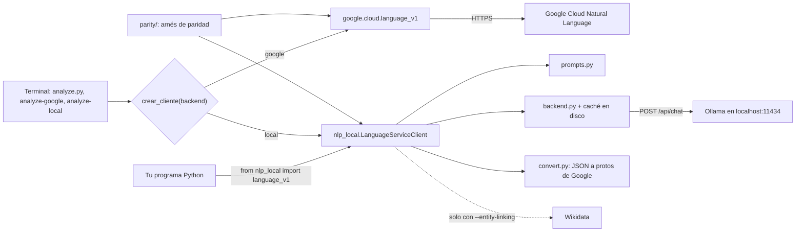

# text-analizer

Análisis de lenguaje natural con **dos motores intercambiables**: la API de **Google Cloud Natural Language** y un
**LLM local vía [Ollama](https://ollama.com)**. Los dos exponen la misma interfaz y devuelven los mismos tipos, así
que cambiar de uno a otro es una línea de import.

| | **Google Cloud NL** | **LLM local (Ollama)** |
|---|---|---|
| Dónde corre | La nube de Google | Tu máquina |
| Tus textos | Salen a Google | No salen de tu equipo |
| Costo | Cuota facturable por llamada | Gratis después del hardware |
| Conexión | Obligatoria | No hace falta |
| Latencia | ~200 ms | ~1–15 s según modelo |
| Precisión | La referencia | **94.4/100** de paridad medida |
| Entity linking | Knowledge Graph nativo | Wikidata (7/7 exactos) |

```python
from google.cloud import language_v1     # nube
from nlp_local import language_v1        # local — todo lo demás igual
```

No es un parecido: `nlp_local` devuelve los objetos proto reales de `google-cloud-language`, así que
`isinstance(r, language_v1.AnalyzeEntitiesResponse)` es cierto y los enums son los mismos objetos.

**Documentación técnica:** [Arquitectura](docs/ARCHITECTURE.md) · [Especificación](docs/SPEC.md) ·
[Pruebas](docs/TESTING.md) · [Arnés de paridad](parity/README.md)

---

## Contenido

- [Funciones principales](#funciones-principales)
- [Arquitectura en breve](#arquitectura-en-breve)
- [¿Cuál de los dos uso?](#cuál-de-los-dos-uso)
- [Empezar en dos minutos](#empezar-en-dos-minutos)
- [Los tres ejecutables](#los-tres-ejecutables)
- [Paridad medida](#paridad-medida)
- [Estructura del repo](#estructura-del-repo)
- [Configuración](#configuración)
- [Pruebas](#pruebas)
- [Estado y limitaciones](#estado-y-limitaciones)
- [Catálogo de análisis](#catálogo-de-análisis) (guía de uso de cada análisis)
- [v1 vs. v2 de la API](#v1-vs-v2-de-la-api)
- [Instalación detallada](#instalación-detallada)

---

## Funciones principales

- **CLI unificado** (`analyze.py`) con 9 análisis: `sentiment`, `sentences`, `entities`, `entity-sentiment`,
  `classify`, `moderate`, `syntax`, `link`, `annotate`; motor elegible con `--backend` y comparación lado a lado
  con `--compare`.
- **`nlp_local`**: reemplazo directo de `google.cloud.language_v1.LanguageServiceClient` respaldado por un LLM
  local; mismas firmas, mismos protos de respuesta y mismos errores (por ejemplo, `InvalidArgument` en
  `classify_text` con textos de menos de 20 tokens).
- **Entity linking local** contra Wikidata (opcional), que reproduce los identificadores del Knowledge Graph.
- **Arnés de paridad** (`parity/`) que usa a Google como maestro y puntúa cuánto se parece el motor local.
- **Referencia comentada** (`main.py`) de los 12 análisis de la API de Google, con salidas reales medidas.

---

## Arquitectura en breve



El motor se elige **una sola vez**, al construir el cliente; a partir de ahí el código es idéntico. El detalle de
componentes, flujos y decisiones está en [docs/ARCHITECTURE.md](docs/ARCHITECTURE.md).

---

## ¿Cuál de los dos uso?

**Usa Google** cuando necesites la respuesta de referencia: producción con presupuesto, *entity linking* contra el
Knowledge Graph, o cuando otro sistema ya depende de sus valores exactos.

**Usa el local** cuando el texto no deba salir de tu máquina (datos personales, clínicos, contratos), cuando
proceses volumen alto y la cuota se dispare, cuando trabajes sin conexión, o para **iterar barato**: desarrollas
contra el local y validas contra Google solo al final.

Y son combinables: prototipa en local, verifica con `--compare`, y decide por análisis. La paridad no es uniforme —
`syntax` está en 98.5 y `sentiment` en 89.6.

---

## Empezar en dos minutos

**Requisitos:** Python 3.10 o superior, y al menos uno de los dos motores (credenciales de Google Cloud con la API
habilitada, u Ollama con un modelo descargado).

Un solo comando crea el entorno virtual, instala todo y te dice qué falta para cada motor:

```bash
./setup.sh
```

```bash
source .venv/bin/activate
```

### Opción A — Google

```bash
gcloud services enable language.googleapis.com
```

```bash
gcloud auth application-default login
```

```bash
./analyze-google sentiment "The food was amazing but the service was terrible."
```

### Opción B — local

Necesitas [Ollama](https://ollama.com) con un modelo descargado:

```bash
ollama pull qwen3:32b
```

El modelo por defecto del código es `qwen3.8:27b-mlx` (`nlp_local/backend.py`). Si descargaste otro, indícalo con
`NLP_LOCAL_MODEL` o con `--model`; si no, Ollama responderá que el modelo no existe:

```bash
export NLP_LOCAL_MODEL=qwen3:32b
```

```bash
./analyze-local sentiment "The food was amazing but the service was terrible."
```

Ambos imprimen lo mismo:

```
score=-0.40   magnitude=0.40
```

No hace falta configurar los dos. `setup.sh` comprueba cada uno por separado y te avisa de cuál está listo.

---

## Los tres ejecutables

| Archivo | Qué hace |
|---|---|
| [`analyze.py`](analyze.py) | CLI unificado, con `--backend` y `--compare` |
| [`analyze-google`](analyze-google) | Atajo que fuerza la API de Google |
| [`analyze-local`](analyze-local) | Atajo que fuerza el LLM local |

Los tres aceptan las mismas opciones y estos análisis: `sentiment`, `sentences`, `entities`, `entity-sentiment`,
`classify`, `moderate`, `syntax`, `link`, `annotate`.

```bash
./analyze-local entities "Apple opened a new store in Mexico City."
```

```bash
./analyze-google classify --file articulo.txt
```

```bash
cat resenas.txt | ./analyze-local --model qwen3.5:9b-mlx sentences
```

```bash
./analyze-local --entity-linking link "Tesla opened a factory in Berlin."
```

| Opción | Efecto |
|---|---|
| `--backend {google,local}` | Motor (por defecto `google`) |
| `--compare` | Corre los dos motores y los muestra lado a lado |
| `--model` | Modelo de Ollama (solo local) |
| `--entity-linking` | Enlaza entidades contra Wikidata (solo local; requiere red) |
| `--file` | Lee el texto de un archivo; también se acepta stdin |
| `--language es` | Idioma del documento; si se omite, se detecta |
| `--html` | Trata la entrada como HTML |

La referencia completa de argumentos, salidas y códigos de salida está en [docs/SPEC.md](docs/SPEC.md#41-cli-analyzepy).

### `--compare`: los dos, lado a lado

La forma rápida de decidir si el modelo local te sirve para **tu** texto:

```bash
./analyze.py --compare entities "Apple opened a new store in Mexico City last Tuesday."
```

```
GOOGLE                                        | LOCAL (qwen3.8:27b-mlx)
----------------------------------------------+------------------------------
Apple        ORGANIZATION  salience=0.648     | Apple        ORGANIZATION  salience=0.644
store        LOCATION      salience=0.317     | store        LOCATION      salience=0.317
Mexico City  LOCATION      salience=0.036     | Mexico City  LOCATION      salience=0.040
```

La paridad llega hasta los errores: un texto demasiado corto para `classify` lanza `InvalidArgument(400)` con el
mismo mensaje en ambos.

> **Nota de diseño.** En [`analyze.py`](analyze.py) no hay ni un `if backend == ...` dentro de la lógica de
> análisis. El motor se elige una vez al construir el cliente y a partir de ahí el código es idéntico. Ese archivo
> existe, en parte, para demostrarlo de forma ejecutable.

---

## Paridad medida

El arnés de [`parity/`](parity/README.md) usa la API de Google **como maestro**: corre ambas implementaciones sobre
el mismo corpus y puntúa cuánto se parecen.

```bash
python -m parity.harness
```

| Análisis | Inicial | Actual |
|---|---:|---:|
| `syntax` | 98.5 | **98.5** |
| `moderate` | 76.7 | **97.2** |
| `classify` | 15.0 | **95.5** |
| `entity_sentiment` | 86.8 | **93.6** |
| `entities` | 82.5 | **91.8** |
| `sentiment` | 72.8 | **89.6** |
| **GLOBAL** | **74.8** | **94.4** |

Lo que más rindió no fueron ajustes de prompt sino **tres leyes estructurales** descubiertas midiendo al maestro:

- El `score` del documento es la **media** de los scores por oración.
- La `magnitude` es la **suma de |score|** por oración.
- La `salience` de todas las entidades **suma exactamente 1.0**.

Explotarlas cambió el diseño: al modelo local se le piden solo cantidades primitivas y el resto se **deriva
aritméticamente**, en vez de pedirle números que daba fuera de escala (8.5 donde Google decía 1.8).

En [`parity/README.md`](parity/README.md) está el método completo, cómo pasó el *entity linking* de 0/7 a 7/7 vía
Wikidata, y las **divergencias que no se pueden cerrar** — incluida una inconsistencia del propio Google, que puntúa
`+0.20` una frase en español y `−0.40` su equivalente en inglés. Las fórmulas de cada métrica están en
[docs/SPEC.md](docs/SPEC.md#6-paridad-google-vs-local).

---

## Estructura del repo

```
setup.sh              crea el venv, instala y comprueba el entorno
requirements.txt      dependencias de ejecución (solo dos)
requirements-dev.txt  + black, ruff, pytest
pyproject.toml        metadatos del paquete, ruff/black, entry point `analyze`

analyze.py            CLI unificado (--backend, --compare)
analyze-google        atajo: API de Google
analyze-local         atajo: LLM local
main.py               referencia comentada de los 12 análisis (API de Google)

nlp_local/            implementación compatible con Ollama
  __init__.py           fachada language_v1 (reexporta los tipos de Google)
  client.py             LanguageServiceClient drop-in
  backend.py            motor de inferencia (modelo reemplazable) + caché
  prompts.py            prompts calibrados contra el maestro
  convert.py            JSON del modelo -> protos de Google
  linking.py            entity linking real contra Wikidata
parity/               arnés de paridad (Google como maestro)
  corpus.py             20 textos y el plan de qué análisis corre sobre cuáles
  harness.py            corre ambos motores, compara y reporta
  metrics.py            una métrica 0-100 por análisis
tests/                pruebas unitarias offline (pytest)
docs/                 arquitectura, especificación y pruebas
.github/workflows/    revisión automática de PR con un LLM (ver docs/TESTING.md)
```

[`main.py`](main.py) es la **referencia**: cada análisis documentado con cuándo usarlo, cuándo no, cómo leer la
salida y ejemplos con valores reales medidos. Usa directamente la API de Google. Los ejecutables son la
**herramienta**.

---

## Configuración

| Variable | Por defecto | Uso |
|---|---|---|
| `NLP_LOCAL_MODEL` | `qwen3.8:27b-mlx` | Modelo de Ollama del motor local |
| `OLLAMA_HOST` | `http://localhost:11434` | Servidor Ollama |
| `NLP_LOCAL_USER_AGENT` | `nlp-local/0.1 (…)` | `User-Agent` para las consultas a Wikidata |
| `GOOGLE_APPLICATION_CREDENTIALS` | — | Llave de cuenta de servicio, si no usas ADC |

Archivos locales que **no** van a git (todos en `.gitignore`):

| Archivo | Qué es |
|---|---|
| `.venv/` | Entorno virtual creado por `setup.sh` |
| `key.json` | Llave opcional de cuenta de servicio de Google (preferible usar ADC) |
| `nlp_local/.cache_llm.json` | Caché de inferencias del LLM (clave: modelo + prompt + texto) |
| `nlp_local/.cache_wikidata.json` | Caché de búsquedas y resoluciones en Wikidata |
| `parity/.cache_google.json` | Respuestas de Google guardadas por el arnés |

Las cachés se pueden borrar en cualquier momento: solo cuestan tiempo de inferencia o cuota al regenerarse.

---

## Pruebas

```bash
./setup.sh --dev
```

```bash
.venv/bin/python -m pytest
```

77 pruebas unitarias offline: el LLM, Ollama, Wikidata y la API de Google se simulan. El arnés de paridad
(`python -m parity.harness`) es la verificación contra los servicios reales y se corre a mano. Detalle, inventario
y resultado en [docs/TESTING.md](docs/TESTING.md).

No hay despliegue: es una herramienta que corre en la máquina de quien la usa. El workflow de GitHub Actions solo
hace revisión automática de pull requests; no corre pruebas.

---

## Estado y limitaciones

- Versión `0.1.0` (`pyproject.toml`), marcada como *Beta*.
- El motor local **no** lee de Cloud Storage, **no** implementa la API v2 y hace una inferencia por feature en
  `annotate_text`.
- La detección automática de idioma del motor local solo distingue español e inglés; declara `--language` para
  otros idiomas.
- `annotate_text` local no aplica *entity linking* aunque el cliente se cree con `entity_linking=True`.
- Los prompts están calibrados contra `qwen3.8:27b-mlx`; con otro modelo conviene medir antes con
  `python -m parity.harness --model ...`.
- Los resultados de paridad publicados no se pueden reproducir sin credenciales de Google y un modelo local.

---

## Catálogo de análisis

Empieza por la pregunta que quieres responder, no por la función:

| Tu pregunta | Función | Ejemplo de uso real |
|---|---|---|
| ¿De **qué o quién** habla este texto? | [`sample_analyze_entities`](main.py) | Etiquetar noticias por marca, lugar o persona |
| ¿Este texto es **positivo o negativo**? | [`sample_analyze_sentiment`](main.py) | Termómetro diario de comentarios en redes |
| ¿Qué opinan de **cada cosa** mencionada? | [`sample_analyze_entity_sentiment`](main.py) | Reseñas: separar "la comida" de "el servicio" |
| ¿A qué **tema** pertenece? | [`sample_classify_text`](main.py) | Archivar artículos por categoría automáticamente |
| ¿Cómo está **construida** la frase? | [`sample_analyze_syntax`](main.py) | Extraer "quién le hizo qué a quién"; palabras clave |
| ¿Este texto es **dañino**? | [`sample_moderate_text`](main.py) | Moderar comentarios antes de publicarlos |
| ¿**Dónde** se tuerce este texto largo? | [`sample_analyze_sentiment_by_sentence`](main.py) | Encontrar la frase exacta que disparó la queja |
| ¿A **qué cosa del mundo** se refiere? | [`sample_link_entities_knowledge_graph`](main.py) | Desambiguar: ¿"Jordan" el país o la persona? |

Y tres variantes que no cambian *qué* se analiza sino *cómo* se pide:

| Tu situación | Función |
|---|---|
| Necesito 2 o más análisis del mismo texto | [`sample_annotate_text`](main.py) — una sola llamada de red |
| Mi entrada es HTML crudo | [`sample_analyze_html`](main.py) |
| Mi entrada está en Cloud Storage | [`sample_analyze_gcs_file`](main.py) — solo Google |

> Con el backend de Google, cada análisis es una llamada facturable aparte (por cada 1.000 caracteres). Con el local no hay cuota, pero cada análisis es una inferencia y el tiempo sí se suma.

Lo que sigue explica **cuándo conviene cada uno y cuándo no**, con salidas reales medidas contra la API oficial.

---

## 1. `sample_analyze_entities` — ¿de qué habla?

Extrae las cosas del mundo real mencionadas: personas, organizaciones, lugares, productos, fechas, direcciones, números.

**Úsalo cuando** quieras saber de qué trata un texto sin leerlo: etiquetar tickets de soporte por producto mencionado, construir filtros de búsqueda por faceta, o enlazar menciones a Wikipedia y al Knowledge Graph (viene en `entity.metadata`) para desambiguar *Jordan* el país de *Jordan* la persona. También sirve como primer filtro de PII: los tipos `PERSON`, `ADDRESS` y `PHONE_NUMBER` marcan lo que hay que anonimizar.

**No lo uses si** lo que buscas es la opinión sobre cada entidad (→ análisis 3) o el tema general del documento (→ análisis 4).

**Cómo leerlo:** `salience` (0–1) mide qué tan central es la entidad *en ese texto*. Mayor a 0.3 suele ser tema principal; menor a 0.05 es mención de pasada.

```python
# "Apple opened a new store in Mexico City last Tuesday."  (salida real)
#   Apple       -> ORGANIZATION, salience 0.648
#   store       -> LOCATION,     salience 0.317
#   Mexico City -> LOCATION,     salience 0.036   <- casi irrelevante

principales = [e.name for e in response.entities if e.salience > 0.2]
# -> ['Apple', 'store']      Mexico City NO entra
```

**Cuidado con la intuición:** "Mexico City" es un nombre propio llamativo y saca menos que el sustantivo común "store". La salience mide centralidad en la frase, no lo importante que te parezca la entidad. La frase trata de que Apple abrió una tienda; la ciudad es circunstancia.

---

## 2. `sample_analyze_sentiment` — ¿positivo o negativo?

Un único veredicto emocional para todo el documento. El más barato y directo.

**Úsalo cuando** el texto hable de un solo asunto y solo necesites el termómetro: encuestas, comentarios sobre una campaña, o priorizar los mensajes más negativos de un buzón.

**No lo uses si** el texto es largo o mezcla temas —los sentimientos opuestos se promedian y se cancelan (→ análisis 3)—. Tampoco detecta sarcasmo.

**La trampa clásica:** `score` (−1 a 1) da la dirección, `magnitude` (0 a ∞) la carga emocional total. Un `score` de 0.0 es ambiguo por sí solo y hay que leerlo junto a la magnitud:

```python
sample_analyze_sentiment("I loved it. Best purchase this year.")
# Score: 0.9   Magnitude: 1.9   -> positivo claro

sample_analyze_sentiment("Great price. Awful build quality.")
# Score: 0.0   Magnitude: 1.8   -> NO es neutral, es MIXTO

sample_analyze_sentiment("The device weighs 300 grams.")
# Score: -0.2  Magnitude: 0.2   -> esto sí es "sin emoción"
```

```python
# Tres cubetas sin caer en la trampa:
if   sentiment.magnitude < 0.5: etiqueta = "sin_emocion"
elif sentiment.score >  0.25:   etiqueta = "positivo"
elif sentiment.score < -0.25:   etiqueta = "negativo"
else:                           etiqueta = "mixto"   # revisar a mano
```

---

## 3. `sample_analyze_entity_sentiment` — ¿qué opinan de cada cosa?

Encuentra las entidades **y** calcula el sentimiento sobre cada una por separado.

**Úsalo cuando** analices reseñas, NPS abiertos o encuestas: es el análisis correcto para opiniones mixtas, que son la mayoría. También para comparar tu marca contra la competencia dentro del mismo comentario, o para priorizar tickets por el componente que genera la queja.

**No lo uses si** el texto habla de una sola cosa (→ análisis 2, más simple) o si no te importa la opinión (→ análisis 1).

```python
sample_analyze_entity_sentiment("The food was amazing but the service was terrible.")
# food     salience=0.730   score=+0.4     (salida real)
# service  salience=0.270   score=-0.4
#
# El análisis 2 sobre esta misma frase habría dicho score ~0.0: inútil.

quejas = [e.name for e in response.entities if e.sentiment.score < -0.25]
# -> ['service']
```

**Calibra con datos reales:** los scores son ±0.4, no ±0.9, aunque "amazing" y "terrible" sean palabras fortísimas. La API es conservadora. Un umbral en ±0.5 te dejaría sin detectar justo este caso — por eso el corte del snippet está en ±0.25.

---

## 4. `sample_classify_text` — ¿de qué tema es?

Asigna el texto a una taxonomía jerárquica predefinida por Google, de ~1.000 categorías (`/Arts & Entertainment/TV & Video/TV Shows`).

**Úsalo cuando** necesites organizar por tema un archivo grande de documentos sin entrenar ningún modelo: enrutar contenido al canal o equipo correcto, recomendar artículos parecidos (dos textos con categorías similares se parecen aunque no compartan una sola palabra), o segmentar por tema.

**No lo uses si** tus categorías son propias del negocio ("devolución", "facturación", "cambio de plan"): esa taxonomía no las contiene y necesitarás un clasificador propio en Vertex AI.

**Requisito que sorprende a todos:** el texto necesita **~20 palabras como mínimo**. Con menos, la API devuelve una lista vacía sin error. Un tuit o el asunto de un correo no alcanzan.

```python
sample_classify_text(
    "That actor on TV makes movies in Hollywood and also stars in "
    "a variety of popular new TV shows."
)
# (salida real)
# /Arts & Entertainment/TV & Video/TV Shows & Programs      0.537
# /Arts & Entertainment/Movies/Other                        0.141
# /Arts & Entertainment/Celebrities & Entertainment News    0.127
# /Arts & Entertainment/Entertainment Industry/Film & TV    0.111

temas = {c.name.split("/")[1] for c in response.categories if c.confidence > 0.1}
# -> {'Arts & Entertainment'}
```

**El umbral 0.5 es más agresivo de lo que parece.** Este texto es inequívocamente sobre televisión y la mejor categoría saca **0.537**, no 0.9: la confianza se reparte entre categorías vecinas plausibles. Un corte en 0.5 deja pasar una sola categoría aquí, y ninguna con un texto algo más ambiguo. Si quieres una etiqueta, ordena por `confidence` y toma la primera; si quieres varias, 0.1–0.2 es más realista.

---

## 5. `sample_analyze_syntax` — ¿cómo está construida la frase?

El análisis de más bajo nivel: divide en oraciones y tokens, y de cada token da su categoría gramatical, su lema y de qué palabra depende.

**Úsalo cuando** necesites materia prima que ningún otro análisis te da:

- Extraer relaciones sujeto–verbo–objeto ("¿quién le hizo qué a quién?") en textos legales, médicos o notas periodísticas.
- Palabras clave **lematizadas**: "corriendo", "corrió" y "corre" colapsan en "correr", así cuentas conceptos y no conjugaciones.
- Segmentar en oraciones de forma confiable, donde `split(".")` falla con "Dr.", "S.A." o "3.14".
- Medir estilo: proporción de voz pasiva, tiempos verbales, densidad de adjetivos.

**No lo uses si** tu pregunta es de significado y no de forma. No reconstruyas sentimiento ni temas a partir de tokens: los otros cuatro análisis ya te lo dan resuelto. Y si solo quieres partir en palabras, un `.split()` o spaCy en local salen gratis; esta llamada se cobra.

```python
# "The dog chased the cat."
#   chased -> VERB, ACTIVE, PAST, lemma "chase", label ROOT

# Quién le hizo qué a quién:
raiz = next(i for i, t in enumerate(response.tokens)
            if t.dependency_edge.label == language_v1.DependencyEdge.Label.ROOT)
partes = {
    language_v1.DependencyEdge.Label(t.dependency_edge.label).name: t.text.content
    for t in response.tokens
    if t.dependency_edge.head_token_index == raiz
}
# -> {'NSUBJ': 'dog', 'DOBJ': 'cat'}
```

```python
# Palabras clave sin conjugaciones repetidas:
from collections import Counter
NOUN = language_v1.PartOfSpeech.Tag.NOUN
Counter(t.lemma for t in response.tokens if t.part_of_speech.tag == NOUN).most_common(10)
```

---

## 6. `sample_moderate_text` — ¿es contenido dañino?

Clasifica el texto contra ~16 categorías de daño: `Toxic`, `Insult`, `Profanity`, `Violent`, `Sexual`, `Death, Harm & Tragedy`, `Firearms & Weapons`, `Illicit Drugs`, `War & Conflict`, `Politics`, `Religion & Belief`, `Health`, `Legal`, `Finance`, `Public Safety`, `Derogatory`.

**Úsalo cuando** moderes contenido generado por usuarios antes de publicarlo, filtres la entrada o salida de un chatbot, o audites un corpus ya publicado para encontrar lo problemático. Sirve para mandar a revisión humana solo lo dudoso en vez de revisarlo todo.

**No lo confundas con:**
- `classify_text` — aquí `Health` o `Politics` significan "toca un tema sensible", **no** "este artículo es de salud".
- `analyze_sentiment` — una queja furiosa puede ser negativa y perfectamente civilizada, sin ninguna señal de toxicidad. Son ejes distintos.

**El detalle que sorprende:** la API devuelve **todas** las categorías en cada llamada, cada una con su `confidence`. No te devuelve "las que aplican". Si imprimes todo verás docenas de líneas con 0.01 = "no aplica". **Siempre hay que filtrar por umbral** (0.5 es un punto de partida razonable).

```python
sample_moderate_text("You are an idiot and I hope you get hurt.")
# (salida real)
# Toxic    : 0.97
# Violent  : 0.95
# Insult   : 0.92
# Profanity: 0.75

BLOQUEAR = {"Toxic", "Insult", "Profanity", "Violent", "Sexual"}
riesgos = [c.name for c in response.moderation_categories
           if c.confidence > 0.5 and c.name in BLOQUEAR]
if riesgos:
    rechazar(motivo=riesgos)
```

Para moderación nueva prefiere [`sample_moderate_text_v2`](main.py), que usa `MODEL_VERSION_2` (más reciente, más idiomas). Ver la nota de versiones abajo.

---

## 7. `sample_analyze_sentiment_by_sentence` — ¿dónde se tuerce?

Desglosa el sentimiento oración por oración, además del global.

**Úsalo cuando** el texto sea largo y el promedio global no diga nada: transcripciones de llamadas, respuestas extensas de encuesta, hilos de correo. Te permite resaltar en la interfaz la frase concreta que disparó la alerta, y seguir el arco de una conversación (si empieza mal y termina bien).

**Lo importante:** este desglose **ya venía** en la respuesta de `analyze_sentiment`, en `response.sentences`. No cuesta ni una llamada extra ni un centavo más — el código simplemente lo estaba tirando a la basura.

```python
sample_analyze_sentiment_by_sentence(
    "The setup was painful. Support took days to answer. "
    "Once running, it works beautifully."
)
# (salida real)
# Global: score=-0.10  magnitude=2.30   <- "casi neutral": no dice nada
#   [-0.80] The setup was painful.
#   [-0.50] Support took days to answer.
#   [+0.90] Once running, it works beautifully.
```

Divide por **posición**, no por tema. Si quieres "¿qué opinan del envío?" sin importar en qué frase se dijo, eso es el análisis 3.

---

## 8. `sample_annotate_text` — varios análisis, una sola llamada

Ejecuta las features que elijas en un único viaje de red.

**Úsalo siempre que necesites dos o más análisis del mismo texto** — el caso más común en la práctica. Pedir entidades y sentimiento por separado son dos peticiones HTTP donde basta una. En procesamiento por lotes, pasar de 4 llamadas a 1 recorta el tiempo total casi a la cuarta parte.

**Ahorra latencia, no dinero.** La facturación es por feature solicitada: pedir 4 features cuesta lo mismo que 4 llamadas separadas. No actives features "por si acaso".

```python
features = {
    "extract_syntax": False,
    "extract_entities": True,
    "extract_document_sentiment": True,
    "extract_entity_sentiment": True,
    "classify_text": False,   # apagado = no se cobra
    "moderate_text": True,
}
response = client.annotate_text(request={
    "document": document, "features": features, "encoding_type": encoding_type,
})
# La respuesta trae todo junto: response.entities, response.document_sentiment,
# response.categories, response.moderation_categories, response.sentences,
# response.tokens
```

---

## 9. `sample_analyze_html` — la entrada es HTML

Pasa HTML crudo con `Document.Type.HTML` en lugar de `PLAIN_TEXT`.

**Úsalo cuando** analices páginas web, correos HTML o contenido de un CMS. Te ahorra escribir un limpiador de etiquetas, y sobre todo evita que el marcado corrompa el análisis.

**Cuidado con el costo:** el HTML cuenta entero para la facturación, etiquetas incluidas. Una página con mucho `<script>` y `<style>` puede costar varias veces más que su texto visible; si la relación marcado/contenido es mala, extrae el `<article>` antes.

```python
sample_analyze_html("<h1>Tesla</h1><p>The company opened a factory in Berlin.</p>")
# (salida real)
# Tesla (ORGANIZATION)   salience=0.42
# company (ORGANIZATION) salience=0.35
# factory (LOCATION)     salience=0.19
# Berlin (LOCATION)      salience=0.04
```

### Por qué importa: el mismo HTML mandado como `PLAIN_TEXT`

Esta es la comparación medida, y es el argumento real para usar `Type.HTML`:

```
HTML  -> Tesla 0.418 | company 0.350 | factory 0.188 | Berlin 0.044
PLAIN -> company 0.650 | factory 0.208 | 'Berlin.' 0.141
```

Mandar HTML como `PLAIN_TEXT` no "ensucia un poco" el resultado: **la entidad principal (Tesla) desaparece del análisis** porque queda pegada al marcado, y aparece una entidad fantasma `'Berlin.'` con el punto dentro. Es la diferencia entre un análisis correcto y uno inservible.

### Lo que el marcado *no* hace

Podrías esperar que meter algo en un `<h1>` le suba la `salience`. **Medido, no ocurre:** con el mismo orden de palabras, Tesla saca `0.464` como texto plano y `0.418` dentro de un `<h1>` — prácticamente igual, y si acaso un pelín menos. Lo que mueve la salience es la posición y la centralidad en la frase, no la etiqueta que la envuelve. No reestructures tu HTML esperando cambiar el ranking de entidades.

---

## 10. `sample_analyze_gcs_file` — la entrada está en Cloud Storage

Pasa el URI del objeto en vez del contenido; la API lo lee directo del bucket.

**Úsalo cuando** los documentos ya vivan en un bucket: te ahorras bajarlos solo para volver a subirlos dentro de la petición, y no cargas archivos grandes en RAM. Encaja especialmente en pipelines serverless (Cloud Functions / Cloud Run) disparados por la subida de un archivo: recibes el evento con el URI y lo pasas tal cual.

**Requisitos que suelen fallar:**
- El formato es `gs://bucket/ruta/archivo.txt`, no una URL `https`.
- La cuenta de servicio necesita `storage.objectViewer` sobre el bucket. **Este es el error número uno:** funciona en local con `content` y truena aquí con un 403 que ni siquiera menciona a Natural Language, sino a Storage.
- Solo texto plano o HTML. Un PDF o un `.docx` no sirven; para eso necesitas Document AI antes.
- `content` y `gcs_content_uri` son un `oneof`: **no falla si mandas los dos** — el segundo borra al primero en silencio y acabas analizando un texto que no querías, sin ver ningún error.

```python
document = {"gcs_content_uri": "gs://mi-bucket/reseñas/2024-01.txt",
            "type_": language_v1.Document.Type.PLAIN_TEXT}
# NO incluyas "content" aquí.
```

---

## 11. `sample_link_entities_knowledge_graph` — ¿a qué cosa del mundo se refiere?

Resuelve cada entidad contra el Knowledge Graph de Google y devuelve su **MID**, un identificador estable como `/m/0k8z`, más su URL de Wikipedia.

**El problema que resuelve:** [`sample_analyze_entities`](main.py) te devuelve el *texto* de la entidad, y las cadenas son ambiguas en las dos direcciones:

- Un texto, varias cosas: "Jordan" es el país, Michael Jordan o la marca Air Jordan.
- Una cosa, varios textos: "IBM", "International Business Machines" y "Big Blue" son la misma empresa y no se parecen en nada como cadenas.

El MID resuelve ambas: es único y estable. Todas las variantes de IBM dan el mismo MID; los dos "Jordan" dan MIDs distintos.

**Úsalo cuando:**
- **Deduplicar entidades entre documentos** — el caso principal. Si agrupas por texto, "IBM" e "International Business Machines" te quedan como dos filas en el reporte; si agrupas por MID, es una.
- Cruzar con datos externos vía la Knowledge Graph Search API: `https://kgsearch.googleapis.com/v1/entities:search?ids=/m/0k8z&key=API_KEY`
- Enlazar cada mención a su artículo de Wikipedia en la interfaz.
- Separar lo conocido de lo desconocido: una entidad **sin** metadata no es un error, es señal. Significa que el Knowledge Graph no la reconoce — suele ser genérica ("the company") o demasiado nueva o local. Eso ya te distingue marcas reales de ruido.

**No lo uses si** tus entidades son internas del negocio (SKUs, clientes, códigos de proyecto): el Knowledge Graph no las conoce y obtendrás metadata vacía en casi todo. Ahí necesitas tu propio catálogo.

```python
sample_link_entities_knowledge_graph(
    "Apple released the iPhone in Cupertino. I ate an apple for breakfast."
)
# (salida real)
# --- Entidades enlazadas al Knowledge Graph ---
# Apple      ORGANIZATION   mid=/m/0k8z      .../wiki/Apple_Inc.
# iPhone     CONSUMER_GOOD  mid=/m/027lnzs   .../wiki/IPhone
# Cupertino  LOCATION       mid=/m/0r679     .../wiki/Cupertino,_California
#
# --- Sin enlace (el Knowledge Graph no las reconoce) ---
# breakfast  OTHER
# apple      OTHER          <- la fruta: mismo texto, sin identidad
```

Ahí está la desambiguación real: `Apple` y `apple` son casi el mismo texto y la API separa la empresa (enlazada, con MID) de la fruta (sin enlazar).

```python
# Agrupar menciones por identidad real y no por escritura:
from collections import Counter
Counter(e.metadata["mid"] for e in response.entities if "mid" in e.metadata)
```

### Límites reales del enlace (medidos, no supuestos)

Conviene saber dónde falla antes de construir algo encima:

**1. Necesita contexto.** Con la frase escueta `"Jordan won six titles with the Bulls. Jordan borders Israel."`, **ninguno** de los dos "Jordan" se enlaza — salen sin MID, tipados `ORGANIZATION` y `PERSON`. Con contexto suficiente sí funciona:

```
"Michael Jordan won six NBA championships with the Chicago Bulls"
  -> Michael Jordan /m/054c1 | NBA /m/05jvx | Chicago Bulls /m/0jm74
```

La API **prefiere no enlazar antes que enlazar mal**. Para tu código es buena noticia (pocos falsos enlaces), pero significa que la tasa de enlace depende mucho de qué tan rico sea el texto.

**2. Los apodos no se resuelven.** Con `"IBM reported earnings. International Business Machines has offices worldwide. Big Blue is old."`, "IBM" se enlaza a `/m/03sc8` y **absorbe "International Business Machines" como mención de la misma entidad** — la deduplicación por nombre formal sí funciona. Pero "Big Blue" sale como `ORGANIZATION` aparte y **sin MID**. No cuentes con que los apodos colapsen solos.

Ojo con un detalle: `wikipedia_url` es opcional **incluso entre las enlazadas** — hay entidades con MID que no tienen artículo en Wikipedia. Por eso el código separa por presencia de `mid`, no de `wikipedia_url`.

**Sobre las versiones y los motores.** Con Google, esto solo funciona en la **v1**: la v2 no devuelve `wikipedia_url`, y lo hace fallando en silencio (ver la sección siguiente). Con el **backend local** funciona activando `--entity-linking`, que resuelve contra Wikidata en vez del Knowledge Graph y reprodujo 7/7 de los identificadores de Google:

```bash
./analyze-local --entity-linking link "Tesla opened a factory in Berlin."
```

---

## v1 vs. v2 de la API

`main.py` usa `language_v1` en todo salvo en `sample_moderate_text_v2`. La v2 **no es "v1 mejorada"**: le quitaron cosas.

| | v1 | v2 |
|---|---|---|
| `analyze_syntax` | ✅ | ❌ no existe |
| `analyze_entity_sentiment` | ✅ | ❌ no existe |
| `salience` en entidades | ✅ | ❌ no viene |
| `wikipedia_url` en metadata | ✅ | ❌ no viene (**falla en silencio**, ver abajo) |
| Modelo de moderación | el antiguo, no elegible | `MODEL_VERSION_2`, más idiomas |
| Idioma | `language` | `language_code` + `language_supported` en la respuesta |

### ¿Por qué faltan? No es un problema de calidad

Es lo contrario: son daño colateral de un cambio de arquitectura hecho **por** calidad.

La v1 es un *pipeline* clásico de NLP supervisado — tokenizar → etiquetar gramaticalmente → construir el árbol de dependencias → resolver entidades → puntuar. Las cuatro cosas de la tabla eran **subproductos que ese pipeline ya calculaba internamente** y exponía casi gratis:

- `analyze_syntax` era el árbol de dependencias, un paso intermedio obligatorio.
- `salience` salía del sistema de ranking de entidades.
- `analyze_entity_sentiment` era la composición de dos etapas: alinear sentimiento con menciones.
- `wikipedia_url` venía de un paso de *entity linking* contra el Knowledge Graph.

La v2 corre sobre modelos **basados en PaLM** (la moderación usa PaLM 2; el clasificador v2 está "distilled from a Large Language Model"). Ese modelo llega a la respuesta por otro camino y no construye ninguno de esos intermedios, así que no hay nada que exponer. El caso de `wikipedia_url` es aún más claro: el enlace al Knowledge Graph es una resolución contra una base de conocimiento externa, un sistema aparte que un modelo generativo no emite por sí solo.

> **Importante:** Google documenta *qué* falta —las notas de versión del 28/08/2023 dicen literalmente "No `salience` field" y "No `wikipedia_url` as metadata"— pero **nunca publicó el porqué**. La explicación de arriba es la lectura más razonable de los hechos documentados, no una declaración oficial de Google.

**La v1 no está deprecada.** Conviven, y el aviso de deprecación que circula es de `v1beta1`, mucho más antigua. Así que la elección no es "vieja vs. nueva", sino **"superficie completa vs. mejor calidad en un subconjunto"**. Por eso el archivo se queda en v1 como base y solo salta a v2 para moderación, que es donde v2 gana claramente.

### La trampa al migrar

La pérdida de `wikipedia_url` **no rompe tu código, y ese es el problema**. El campo `metadata` sigue existiendo en el `Entity` de v2 (lo verifiqué contra la librería): simplemente llega vacío. Si migras a v2 un pipeline que enlazaba entidades, no vas a ver ningún error — vas a ver enlaces que desaparecen sin avisar.

```python
# En v1 esto trae la URL. En v2 devuelve el default, sin lanzar ninguna excepción.
url = entity.metadata.get("wikipedia_url", "(sin artículo)")
```

---

## Instalación detallada

### Requisito: Python 3.10 o superior

`google-cloud-language` todavía admite 3.9, pero sus propias librerías emiten un `FutureWarning` **en cada import** avisando de que dejaron de soportarla. El proyecto arranca, pero cada comando escupe cuatro avisos antes de la salida real. 3.10 es el primer intérprete donde eso no pasa.

```bash
brew install python@3.12    # macOS, si no lo tienes
```

### Entorno virtual — la vía corta

[`setup.sh`](setup.sh) elige el mejor intérprete disponible, crea `.venv`, instala las dependencias y comprueba el entorno:

```bash
./setup.sh
```

```bash
./setup.sh --dev              # además: black, ruff, pytest
```

```bash
./setup.sh --python python3.12   # forzar un intérprete concreto
```

Es idempotente: si el entorno ya existe, actualiza las dependencias en vez de fallar. Al terminar comprueba por separado los dos motores —Ollama y las credenciales de Google— y te dice cuál está listo y qué falta para el otro, en vez de dejar que lo descubras en el primer error.

**Activar y desactivar el entorno:**

```bash
source .venv/bin/activate
```

```bash
deactivate
```

### Entorno virtual — a mano

```bash
python3.12 -m venv .venv && source .venv/bin/activate
```

```bash
pip install --upgrade pip && pip install -r requirements.txt
```

### Los archivos de dependencias

| Archivo | Para qué |
|---|---|
| [`requirements.txt`](requirements.txt) | Ejecución. Solo dos paquetes |
| [`requirements-dev.txt`](requirements-dev.txt) | Lo anterior más `black`, `ruff` y `pytest` |
| [`pyproject.toml`](pyproject.toml) | Metadatos del paquete, para `pip install -e .` |

La lista es corta porque lo es de verdad: fuera de `google-cloud-language` y `six`, **todo el código —`nlp_local` incluido— usa solo la biblioteca estándar**.

Dos cosas que suelen sorprender y están explicadas en los propios archivos:

- **`google-cloud-language` hace falta aunque solo uses el motor local.** `nlp_local` no llama a Google, pero reutiliza sus clases proto para construir las respuestas. Es lo que hace que la compatibilidad sea exacta y no aproximada.
- **`six` se usa en una sola línea** ([`main.py:459`](main.py:459)), un resto de compatibilidad con Python 2 donde `six.binary_type` es literalmente `bytes`. Se conserva para no alterar el ejemplo original; si quieres quitar la dependencia, cambia esa línea por `isinstance(content, bytes)` y borra el import.

### Instalación como paquete

Para que `nlp_local` sea importable desde cualquier directorio y no solo desde la raíz del repo:

```bash
pip install -e .
```

Eso además deja el comando `analyze` en el PATH del entorno, equivalente a `./analyze.py` pero utilizable desde donde estés:

```bash
analyze --backend local entities "Tesla opened a factory in Berlin."
```

### Opción A — Google Cloud

**1. Habilita la API** (una vez; requiere billing activo en el proyecto):

```bash
gcloud services enable language.googleapis.com
```

**2. Autentícate.** La vía recomendada por Google para desarrollo local son las **Application Default Credentials (ADC)** — credenciales de tu propio usuario, de vida corta y renovables, sin ningún archivo de llave permanente que se pueda filtrar en un commit:

```bash
gcloud auth application-default login
```

```bash
gcloud auth application-default set-quota-project TU_PROYECTO
```

#### ¿Y el `key.json`?

No hace falta para desarrollo local, y es preferible no tenerlo: una clave de cuenta de servicio es una credencial **de vida ilimitada** que queda en disco y funciona para quien la copie. Google mismo la considera la opción menos recomendable cuando existe alternativa.

Solo la necesitas para **desplegar en un servidor**, donde no hay un humano que pueda hacer login. En ese caso deja el archivo como `key.json` junto a `main.py` y `main.py` lo detecta y lo usa automáticamente. `analyze.py` y el arnés no lo buscan: para ellos exporta `GOOGLE_APPLICATION_CREDENTIALS=./key.json`. Ya está en `.gitignore`; **no lo subas**.

### Opción B — LLM local

**1. Instala [Ollama](https://ollama.com)** y descarga un modelo. Cualquiera con buen seguimiento de instrucciones sirve; los prompts están calibrados contra `qwen3.8:27b-mlx`. Ese es también el modelo por defecto si no indicas otro.

```bash
ollama pull qwen3:32b
```

**2. Elige el modelo**, por precedencia:

```python
LanguageServiceClient(model="gemma3:27b")   # explícito
```

```bash
export NLP_LOCAL_MODEL=qwen3:32b            # por entorno
```

**3. Comprueba la paridad de tu modelo** antes de confiar en él:

```bash
python -m parity.harness --model tu-modelo
```

Esto importa: un modelo distinto puede necesitar recalibración. Un 9B devolvía `magnitude` **8.5** donde Google decía **1.8**.

#### Rendimiento

Los modelos de razonamiento traen el *thinking* activado por defecto y eso arruina esta tarea: medido, una sola llamada de sentimiento pasaba de **~1 s a 70–108 s** y devolvía prosa en markdown en vez de JSON. `nlp_local` lo desactiva (`think=False`) y limita los tokens de salida. No lo vuelvas a encender para anotación estructurada.

Hay caché en disco de las inferencias, con clave que incluye modelo y prompt: repetir un texto es gratis, y editar un prompt invalida solo lo afectado.

#### Qué no hace el backend local

- **Cloud Storage** (`gcs_content_uri`): descarga el contenido tú y pásalo en `content`.
- **API v2**: solo se implementa v1.
- **`annotate_text`** hace una llamada al modelo por cada feature activada. Ahorra código, no tiempo.
- **Entity linking** requiere `--entity-linking` y consulta Wikidata, así que necesita red. Sin él, los identificadores del Knowledge Graph se omiten a propósito: pedírselos de memoria al modelo daba **0 aciertos de 7**, y un MID inventado corrompe deduplicaciones en silencio.

---

## Nota sobre el idioma

Las funciones de [`main.py`](main.py) heredadas del ejemplo original fijan `language = "en"`. Si vas a analizar texto en español, cambia esa constante a `"es"` o elimina la clave `"language"` para que se detecte sola. Si no lo haces, **no obtendrás un error**: se interpretará mal el texto y devolverá resultados sin sentido de forma silenciosa.

En el CLI se controla con `--language es`, y si se omite se detecta.

Con el backend local esto importa menos —los modelos son multilingües y la moderación en español funcionó sin configurar nada—, pero conviene declararlo igual para que ambos motores reciban lo mismo.
