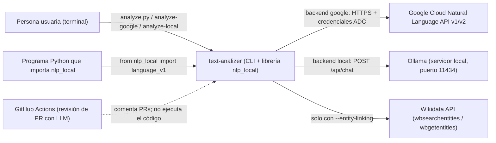
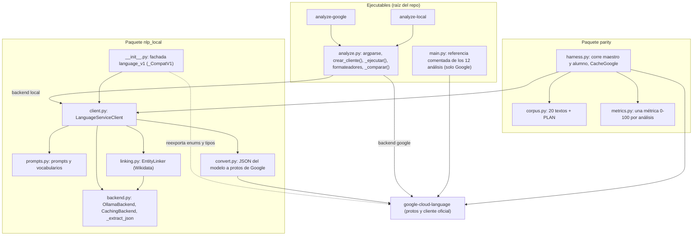
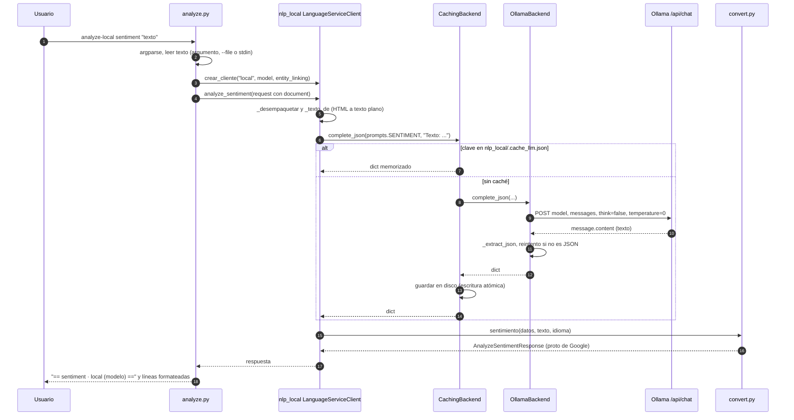
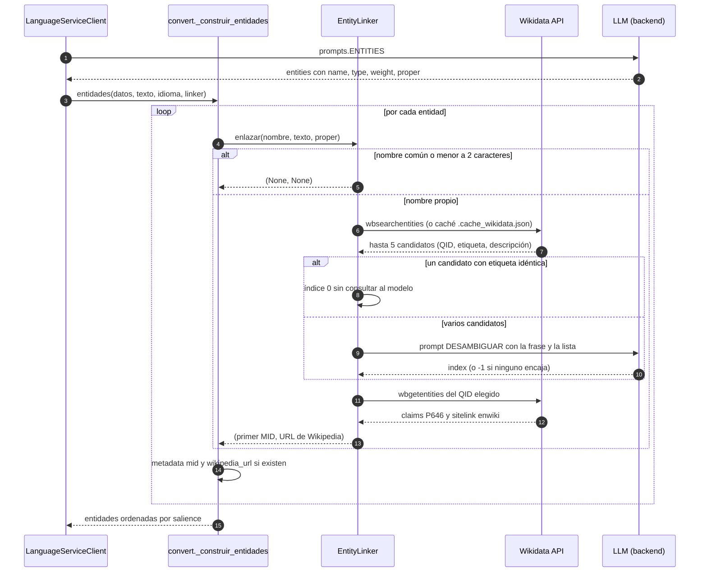
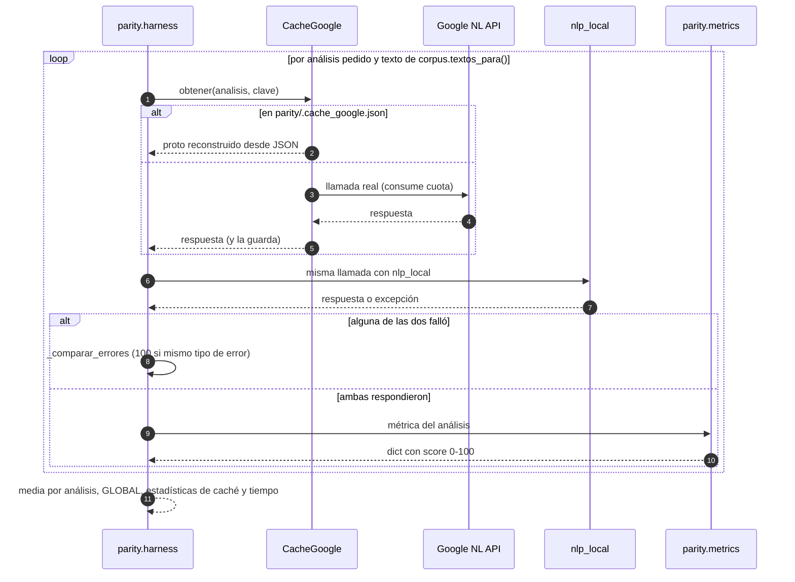
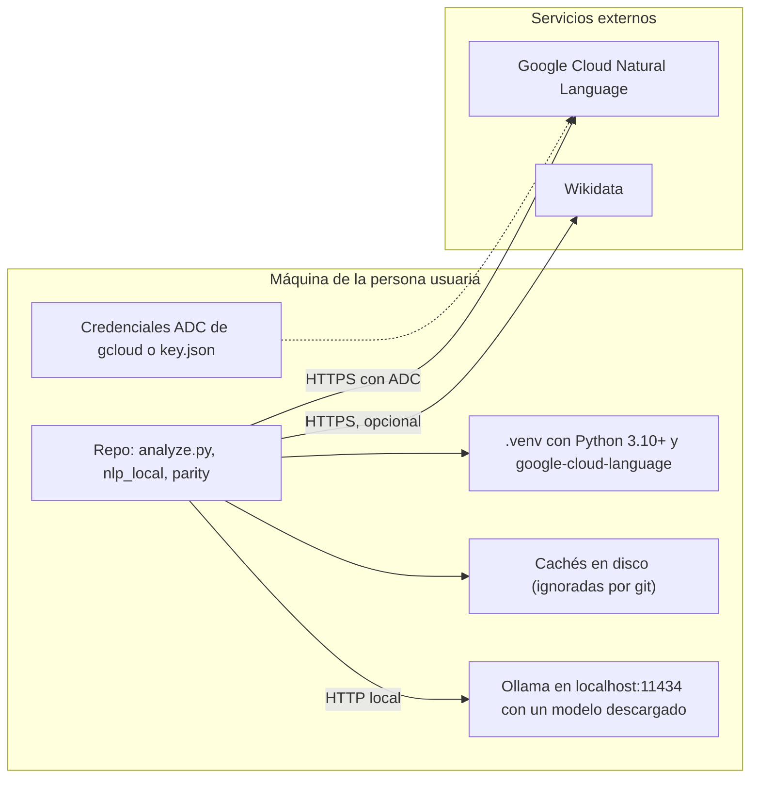

# Arquitectura

Este documento describe cómo está construido `text-analizer`: qué piezas tiene, cómo fluyen los datos entre
ellas, dónde corre cada una y qué decisiones de diseño se ven en el código. Todo lo que se afirma aquí sale del
código versionado; donde algo no se puede determinar desde el repo, se dice.

- Requisitos y contratos: [SPEC.md](SPEC.md)
- Pruebas: [TESTING.md](TESTING.md)

---

## 1. Contexto

`text-analizer` es una herramienta de línea de comandos y una pequeña librería de Python. No es un servicio: no
expone puertos ni corre en un horario. La usa una persona desarrolladora en su máquina, o un programa de Python que
importa `nlp_local` en lugar de `google.cloud.language_v1`.

| Actor o sistema | Rol | Obligatorio |
|---|---|---|
| Google Cloud Natural Language | Motor "maestro": la referencia de compatibilidad | Solo para `--backend google`, `--compare` y el arnés de paridad |
| Ollama | Servidor de inferencia local que ejecuta el LLM | Solo para `--backend local` |
| Wikidata | Base de conocimiento para *entity linking* local | Solo con `--entity-linking` / `entity_linking=True` |
| GitHub Actions | Revisión automática de pull requests con un LLM externo | No; no afecta la ejecución |

---

## 2. Componentes

### 2.1 Ejecutables

| Archivo | Responsabilidad |
|---|---|
| `analyze.py` | CLI unificado. `crear_cliente(backend, model, entity_linking)` es el **único** punto donde se distingue el motor; `_ejecutar()` despacha el análisis y los `_f_*` formatean la respuesta como líneas de texto. `--compare` corre los dos motores y los imprime lado a lado. También es el *entry point* `analyze` del paquete (`pyproject.toml`). |
| `analyze-google`, `analyze-local` | Atajos de 24 líneas: quitan cualquier `--backend` de `argv` y añaden `--backend google` o `--backend local` antes de llamar a `analyze.main`. |
| `main.py` | Material de referencia: 12 funciones `sample_*` documentadas (cuándo usar cada análisis, cuándo no, salidas reales). Usa la API de Google (`language_v1` y `language_v2`) y detecta un `key.json` junto al archivo. No lo importa ningún otro módulo. |
| `setup.sh` | Crea `.venv`, instala dependencias (`--dev` para las de desarrollo) y comprueba si Ollama y las credenciales de Google están disponibles. |

### 2.2 `nlp_local`: reemplazo directo del cliente de Google

| Módulo | Qué hace | Detalles relevantes |
|---|---|---|
| `__init__.py` | Exporta `LanguageServiceClient`, `OllamaBackend`, `CachingBackend`, `BackendError` y `language_v1`. | `language_v1` es un objeto `_CompatV1` que delega todo atributo en `google.cloud.language_v1` salvo `LanguageServiceClient`, así que enums y tipos son **los mismos objetos** que los de Google. |
| `client.py` | `LanguageServiceClient` con los métodos `analyze_sentiment`, `analyze_entities`, `analyze_entity_sentiment`, `classify_text`, `moderate_text`, `analyze_syntax`, `annotate_text`. | Acepta `request` como dict o proto, o `document` suelto; ignora `credentials=`, `client_options=`, etc. Desmarca HTML antes de enviarlo al modelo. Rechaza `gcs_content_uri` con `NotImplementedError`. Replica el `InvalidArgument` de Google en `classify_text` con menos de 20 tokens. Detecta idioma es/en con una heurística si el documento no lo declara. |
| `prompts.py` | Un *system prompt* por análisis más vocabularios (`ENTITY_TYPES`, `POS_TAGS`, `DEP_LABELS_COMUNES`, `MODERATION_CATEGORIES`, `CLASSIFICATION_TOP_LEVEL`) y `CLASSIFY_MIN_TOKENS = 20`. | Las reglas de calibración salen de comparar contra Google (por ejemplo, "nunca 0.0 exacto" en sentimiento, `store` es `LOCATION`). |
| `backend.py` | `OllamaBackend.complete_json()` llama a `POST {OLLAMA_HOST}/api/chat` y devuelve un dict. `CachingBackend` lo envuelve con caché en disco. | `think=False`, `temperature=0.0`, `num_predict=1024` (4096 para sintaxis), `timeout=300`, `retries=2`. Ante JSON inválido reintenta endureciendo la instrucción; ante error de red falla de inmediato con `BackendError`. `_extract_json` tolera bloques markdown y prosa alrededor. |
| `convert.py` | Construye los protos reales (`AnalyzeSentimentResponse`, etc.) desde el JSON del modelo. | Aplica las "leyes" medidas contra Google: score de documento = media de oraciones, magnitude = suma de \|score\| × 1.05, salience normalizada a suma 1.0. Calcula offsets buscando cada fragmento en el texto. Tolera enums inventados, campos ausentes e índices fuera de rango. No emite MIDs del modelo (`EMITIR_MIDS = False`). |
| `linking.py` | `EntityLinker.enlazar(nombre, contexto, es_propio)` devuelve `(mid, wikipedia_url)`. | Solo enlaza nombres propios. Candidatos de Wikidata → el LLM elige un índice (o -1) → `P646` (Freebase MID, el primero) y sitelink `enwiki`. Pausa mínima de 0.6 s entre llamadas, reintentos ante 429 y contadores separados `enlazadas` / `rechazadas` / `fallos_red`. |

### 2.3 `parity`: arnés de paridad

| Módulo | Qué hace |
|---|---|
| `corpus.py` | 20 textos con clave (`sent-*`, `ent-*`, `clas-*`, `mod-*`, `syn-*`, `es-*`) y `PLAN`, que decide qué análisis corre sobre qué prefijos. |
| `harness.py` | `evaluar()` corre Google y `nlp_local` sobre cada texto del plan, compara también las excepciones (`_comparar_errores`) y reporta una media 0-100 por análisis y una global. `CacheGoogle` guarda las respuestas del maestro en `parity/.cache_google.json`. |
| `metrics.py` | Una función por análisis (`sentiment`, `entities`, `classify`, `moderate`, `syntax`) que devuelve métricas crudas y un `score` ponderado por lo que notaría un consumidor. |

---

## 3. Flujos de datos

### 3.1 Análisis con el backend local

Con el backend `google` el flujo es el mismo hasta `crear_cliente`, que devuelve
`google.cloud.language_v1.LanguageServiceClient()`; desde ahí `_ejecutar()` y los formateadores son idénticos.

### 3.2 Entity linking local contra Wikidata

### 3.3 Arnés de paridad

---

## 4. Modelo de despliegue

No hay despliegue en servidores. Todo corre en la máquina de quien lo usa:

| Pieza | Dónde vive | Notas |
|---|---|---|
| Código | Clon del repo | Se ejecuta desde la raíz, o instalado con `pip install -e .` (crea el comando `analyze`). |
| Entorno | `.venv/` | Lo crea `setup.sh`; está en `.gitignore`. |
| Cachés | `nlp_local/.cache_llm.json`, `nlp_local/.cache_wikidata.json`, `parity/.cache_google.json` | Ignoradas por git. Se pueden borrar sin perder nada más que tiempo o cuota. |
| Credenciales de Google | ADC de `gcloud` o `key.json` en la raíz | `key.json` está en `.gitignore`. Solo `main.py` lo detecta automáticamente (ver SPEC, RNF-05). |
| Modelo local | Ollama | El default es `qwen3.8:27b-mlx` (`backend.py`), sobreescribible con `NLP_LOCAL_MODEL` o `--model`. |

---

## 5. Dependencias externas y cuotas

| Dependencia | Uso | Límites o costo conocidos en el código |
|---|---|---|
| `google-cloud-language>=2.13.0,<3.0.0` | Cliente oficial y **protos de respuesta**, que `nlp_local` reutiliza aunque no llame a Google | El piso 2.13 es por `moderate_text` y `language_v2`. |
| `six>=1.16.0` | Una línea de `main.py` (`six.binary_type`) | Vestigio de Python 2, documentado en `requirements.txt`. |
| Google Cloud Natural Language | Backend `google` | Facturable por feature y por cada 1.000 caracteres; el arnés cachea las respuestas para no repetir llamadas. |
| Ollama | Backend `local` | Sin cuota; latencia de ~1 a 15 s por llamada según el modelo (medido por el autor, ver README). |
| Wikidata | *Entity linking* local | Devuelve 429 si se consulta seguido: pausa de 0.6 s, hasta 5 reintentos con espera creciente y `User-Agent` configurable (`NLP_LOCAL_USER_AGENT`). |

Fuera de esas dos dependencias de Python, todo el código usa la biblioteca estándar (`json`, `os`, `re`, `time`,
`urllib`).

---

## 6. Decisiones de diseño

Estas decisiones se ven en el código y en sus comentarios:

1. **Reutilizar los protos de Google en vez de definir tipos propios** (`convert.py`). La compatibilidad es exacta
   por construcción: `isinstance(r, language_v1.AnalyzeEntitiesResponse)` es cierto y los enums comparan igual. El
   costo es depender de `google-cloud-language` incluso para el motor local.
2. **Un solo punto de selección de motor** (`analyze.crear_cliente`). Después de construir el cliente no hay
   ninguna rama por backend; `analyze.py` existe en parte para demostrarlo.
3. **Pedirle al modelo solo cantidades primitivas y derivar el resto** (`convert.sentimiento`,
   `_construir_entidades`). El score del documento, la magnitude y la salience se calculan aritméticamente porque
   el modelo devolvía valores fuera de escala.
4. **No inventar identificadores**. Los MID que propone el modelo se descartan (`EMITIR_MIDS = False`); el
   *entity linking* solo existe vía Wikidata, donde el modelo elige entre candidatos reales.
5. **Replicar también los errores de Google**: `classify_text` lanza `InvalidArgument` con el mismo mensaje por
   debajo de 20 tokens, y el arnés puntúa "los dos fallan igual" como paridad.
6. **Determinismo y caché**: `temperature=0.0` y caché en disco con clave `[modelo, prompt, texto, num_predict]`,
   de modo que editar un prompt invalida solo lo afectado.
7. **Sin dependencia de decodificación por gramática**: los modelos MLX de Ollama ignoran `format`, así que el
   JSON se extrae del texto (`_extract_json`) y se reintenta si no es válido.
8. **Funcionar sin conexión por defecto**: el *entity linking* (que necesita red) va apagado salvo que se pida.
