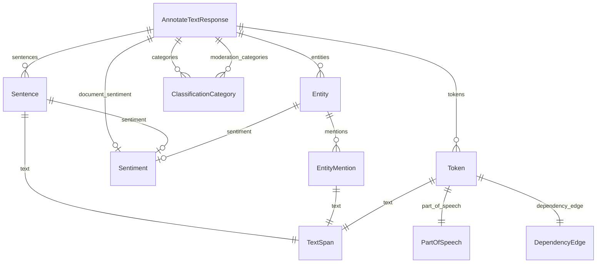

# Especificación

Especificación funcional de `text-analizer` en estilo *spec-driven development*: qué debe hacer, con qué contratos
y cómo se verifica. Cada requisito apunta al módulo que lo implementa y, cuando existe, a la prueba que lo cubre
(`tests/…`, ver [TESTING.md](TESTING.md)). La arquitectura está en [ARCHITECTURE.md](ARCHITECTURE.md).

---

## 1. Propósito y alcance

**Propósito.** Ofrecer análisis de lenguaje natural (sentimiento, entidades, sentimiento por entidad,
clasificación, moderación, sintaxis y *entity linking*) con dos motores intercambiables:

- la API oficial de **Google Cloud Natural Language** (v1, y v2 para moderación en `main.py`), y
- un **LLM local vía Ollama**, empaquetado en `nlp_local` como reemplazo directo de
  `google.cloud.language_v1.LanguageServiceClient`.

**Dentro del alcance**

- CLI `analyze.py` y sus atajos `analyze-google` / `analyze-local`.
- Librería `nlp_local` compatible con la interfaz y los tipos de `language_v1`.
- Arnés `parity` que mide cuánto se parece el motor local al de Google.
- `main.py` como referencia comentada de la API de Google.

**Fuera del alcance** (declarado en el código)

- Lectura desde Cloud Storage en el motor local (`gcs_content_uri`).
- API v2 en el motor local.
- Paralelismo o ahorro de latencia en `annotate_text` local (una llamada al modelo por feature).
- Autenticación, cuotas y errores de red propios de Google dentro de `nlp_local`.

---

## 2. Requisitos funcionales

| ID | Requisito | Implementación | Pruebas |
|---|---|---|---|
| RF-01 | El CLI ejecuta uno de 9 análisis: `sentiment`, `sentences`, `entities`, `entity-sentiment`, `classify`, `moderate`, `syntax`, `link`, `annotate`. | `analyze.ANALISIS`, `_ejecutar` | `test_cli.py::test_lista_de_analisis` |
| RF-02 | El motor se elige con `--backend {google,local}` (por defecto `google`) en un único punto; la lógica de análisis no ramifica por motor. | `analyze.crear_cliente` | `test_cli.py::test_main_backend_local` |
| RF-03 | El texto se lee, en orden de precedencia, de `--file`, del argumento posicional o de stdin; se recorta y no puede quedar vacío. | `analyze.main` | `test_main_lee_archivo`, `test_main_lee_stdin`, `test_main_texto_vacio` |
| RF-04 | `--compare` corre ambos motores sobre el mismo texto y los imprime en dos columnas; un fallo en un motor se muestra como `ERROR Tipo: mensaje` sin abortar el otro. | `analyze._comparar`, `_seguro` | `test_compare_lado_a_lado`, `test_seguro_convierte_excepcion` |
| RF-05 | `analyze-google` y `analyze-local` fuerzan su motor y pasan el resto de argumentos sin cambios. | `analyze-google`, `analyze-local` | `test_atajos_fuerzan_backend` |
| RF-06 | `nlp_local.language_v1` reexporta los enums y tipos reales de Google y solo sustituye `LanguageServiceClient`. | `nlp_local/__init__.py` | `test_client.py::test_fachada_language_v1_reusa_tipos_reales` |
| RF-07 | El cliente local acepta `request` como dict o proto, o `document` suelto, e ignora argumentos propios de Google (`credentials`, `client_options`…). | `client._desempaquetar`, `__init__` | `test_request_como_proto_y_document_suelto`, `test_acepta_kwargs_de_google` |
| RF-08 | Las respuestas del cliente local son instancias de los protos de Google (`AnalyzeSentimentResponse`, etc.). | `convert.py` | `test_analyze_sentiment_devuelve_proto`, `test_convert.py` |
| RF-09 | Sentimiento: score del documento = media de los scores por oración; magnitude = Σ\|score\| × 1.05; scores en pasos de 0.1 y acotados a [-1, 1]. | `convert.sentimiento` | `test_convert.py::TestSentimiento` |
| RF-10 | Entidades: la salience se normaliza a suma 1.0 desde un peso 0-100; se ordenan por salience descendente; un tipo desconocido cae a `OTHER`. | `convert._construir_entidades` | `TestEntidades` |
| RF-11 | Sin *entity linking*, los MID propuestos por el modelo **no** se emiten; `wikipedia_url` solo si empieza por `http`. | `convert.EMITIR_MIDS` | `test_mid_del_modelo_se_suprime` |
| RF-12 | `classify_text` lanza `InvalidArgument("Invalid text content: too few tokens (words) to process.")` con menos de 20 tokens (palabras y signos de puntuación) y sin llamar al modelo. | `client.classify_text`, `contar_tokens` | `test_classify_texto_corto_lanza_invalid_argument`, `test_classify_umbral_exacto` |
| RF-13 | `moderate_text` devuelve siempre las 16 categorías en el orden de Google; las ausentes valen 0.05. | `convert.moderacion`, `prompts.MODERATION_CATEGORIES` | `test_moderacion_siempre_16_en_orden` |
| RF-14 | Sintaxis: un `head` fuera de rango se reemplaza por el índice del propio token; POS/label desconocidos caen a `UNKNOWN`. | `convert.sintaxis` | `test_sintaxis_head_fuera_de_rango` |
| RF-15 | Un documento HTML se convierte a texto plano (sin `<script>`, `<style>`, etiquetas ni entidades básicas) antes de enviarlo al modelo. | `client._quitar_marcado` | `test_html_se_desmarca_antes_del_modelo` |
| RF-16 | Si el documento no declara idioma, se detecta `es` o `en` con una heurística y se informa en `response.language`. | `client._detectar_idioma` | `test_detectar_idioma` |
| RF-17 | *Entity linking* local (opcional): solo nombres propios; candidatos de Wikidata; el LLM elige un índice o -1; se resuelve el primer `P646` y el sitelink `enwiki`. | `linking.EntityLinker`, `resolver` | `test_linking.py` |
| RF-18 | Los fallos de red de Wikidata se cuentan en `fallos_red`, separados de `rechazadas`. | `EntityLinker.enlazar` | `test_fallo_de_red_se_cuenta_aparte` |
| RF-19 | `annotate_text` local hace una llamada al modelo por feature activada y funde los resultados en un `AnnotateTextResponse`. | `client.annotate_text`, `convert.anotacion` | `test_annotate_text_una_llamada_por_feature`, `test_anotacion_funde_parciales` |
| RF-20 | El arnés de paridad compara Google y local sobre el corpus según `PLAN`, puntúa 0-100 por análisis y reporta una media global. | `parity.harness.evaluar` | `test_parity_metrics.py` (métricas; la corrida completa requiere Google) |
| RF-21 | En el arnés, que ambos motores lancen el mismo tipo de excepción puntúa 100; tipos distintos 40; solo uno falla 0. | `harness._comparar_errores` | `test_comparar_errores` |
| RF-22 | `setup.sh` crea o actualiza `.venv` con Python ≥ 3.10, instala dependencias y comprueba Ollama y credenciales de Google. | `setup.sh` | Sin prueba automatizada |

---

## 3. Requisitos no funcionales

| ID | Requisito | Cómo se cumple |
|---|---|---|
| RNF-01 Privacidad | Con el motor local, el texto no sale de la máquina. | `nlp_local` solo habla con `OLLAMA_HOST` (por defecto `http://localhost:11434`); la única salida a Internet es Wikidata con `entity_linking=True`, y solo envía el **nombre** de la entidad. |
| RNF-02 Costo | El motor local no consume cuota; el arnés no repite llamadas facturables. | `CacheGoogle` en `parity/.cache_google.json`; `PLAN` limita qué análisis corre sobre qué textos. |
| RNF-03 Determinismo | La misma entrada da la misma salida en el motor local. | `temperature=0.0`; caché con clave `[modelo, system_prompt, user_prompt, num_predict]`. |
| RNF-04 Rendimiento | Una llamada local típica tarda segundos, no minutos. | `think=False` (con razonamiento activado se medían 70-108 s) y `num_predict=1024` (4096 en sintaxis). `timeout=300` s por llamada. |
| RNF-05 Seguridad de credenciales | No hay llaves en el repo. | Se recomienda ADC (`gcloud auth application-default login`). `key.json` está en `.gitignore`; `main.py` lo usa si existe junto al archivo. `analyze.py` y el arnés usan el mecanismo estándar de Google (ADC o `GOOGLE_APPLICATION_CREDENTIALS`) y **no** detectan `key.json` por sí mismos. |
| RNF-06 Robustez | Una salida defectuosa del modelo no tumba la llamada. | `_extract_json` (bloques markdown, prosa, recorte balanceado), reintento con instrucción reforzada, y valores por defecto en `convert.py`. |
| RNF-07 Cortesía con Wikidata | No provocar bloqueos por frecuencia. | Pausa mínima de 0.6 s, reintentos ante 429 con espera de 2 s × intento, `User-Agent` propio y caché permanente en `nlp_local/.cache_wikidata.json`. |
| RNF-08 Dependencias mínimas | Instalación corta. | Solo `google-cloud-language` y `six`; el resto es biblioteca estándar. |
| RNF-09 Compatibilidad de Python | Python ≥ 3.10. | `pyproject.toml` (`requires-python = ">=3.10"`) y `setup.sh`. |

---

## 4. Contratos e interfaces

### 4.1 CLI `analyze.py`

```
analyze.py [-h] [--backend {google,local}] [--compare] [--model MODEL]
           [--entity-linking] [--file FILE] [--language LANGUAGE] [--html]
           {sentiment,sentences,entities,entity-sentiment,classify,moderate,syntax,link,annotate}
           [texto]
```

| Argumento | Tipo | Por defecto | Efecto |
|---|---|---|---|
| `analisis` | posicional, obligatorio | — | Uno de los 9 análisis. |
| `texto` | posicional, opcional | — | Texto a analizar. Si falta, se usa `--file` o stdin. |
| `--backend` | `google` \| `local` | `google` | Motor a usar. Ignorado con `--compare`. |
| `--compare` | bandera | apagado | Corre ambos motores y los muestra lado a lado. |
| `--model` | cadena | `NLP_LOCAL_MODEL` o `qwen3.8:27b-mlx` | Modelo de Ollama (solo local). |
| `--entity-linking` | bandera | apagado | Activa el enlace contra Wikidata (solo local; requiere red). |
| `--file` | ruta | — | Lee el texto de un archivo UTF-8. Tiene precedencia sobre `texto`. |
| `--language` | código | detectado | Se envía como `document.language`. |
| `--html` | bandera | apagado | Envía el documento como `Document.Type.HTML`. |

Equivalencias por análisis:

| Análisis CLI | Método del cliente | Salida impresa |
|---|---|---|
| `sentiment` | `analyze_sentiment` | `score=… magnitude=…` y aviso `MIXTO` si \|score\| < 0.15 y magnitude ≥ 1.0 |
| `sentences` | `analyze_sentiment` | Global más `[score] oración` por línea |
| `entities` | `analyze_entities` | `nombre tipo salience=… [mid=…]` |
| `entity-sentiment` | `analyze_entity_sentiment` | Igual que `entities` más `sentiment=…` |
| `classify` | `classify_text` | `ruta confianza` |
| `moderate` | `moderate_text` | Solo categorías con confianza ≥ 0.5, de mayor a menor |
| `syntax` | `analyze_syntax` | `token POS lemma=… head=… LABEL` |
| `link` | `analyze_entities` | Bloques "enlazadas al Knowledge Graph" y "sin enlace" |
| `annotate` | `annotate_text` (entidades, sentimiento, sentimiento por entidad, clasificación, moderación; sin sintaxis) | Secciones por feature |

Salida y códigos de salida:

- Modo normal: una cabecera `== <analisis> · <backend>[ (<modelo>)] ==` y las líneas del formateador. Código `0`.
- Errores de argumentos (análisis desconocido, texto ausente o vacío): mensaje de `argparse` y código `2`.
- Si `nlp_local` no se puede importar: mensaje y código `1`.
- Una excepción del motor en modo normal (por ejemplo `InvalidArgument` o `BackendError`) **no se captura** y
  termina con traceback; en `--compare` se muestra como `ERROR Tipo: mensaje`.

Criterios de aceptación:

- **Dado** el motor local disponible, **cuando** se ejecuta `./analyze-local sentiment "Great price. Awful build quality."`,
  **entonces** la primera línea es `== sentiment · local (<modelo>) ==` y la segunda empieza por `score=`.
- **Dado** un texto de menos de 20 tokens, **cuando** se pide `classify` con cualquiera de los dos motores,
  **entonces** ambos terminan con `InvalidArgument` y el mismo mensaje.
- **Dado** `--compare`, **cuando** un motor falla, **entonces** su columna muestra `ERROR …` y la otra columna se
  imprime igual.

### 4.2 Arnés `parity.harness`

```
python -m parity.harness [analisis ...] [--model MODEL] [--no-cache]
```

- `analisis`: subconjunto de `sentiment`, `entities`, `entity_sentiment`, `classify`, `moderate`, `syntax`
  (todos si se omite). Un nombre desconocido termina con error de `argparse`.
- `--no-cache`: no lee las cachés de Google ni del LLM (las respuestas nuevas se siguen guardando en la de Google).
- Requiere credenciales de Google porque construye `language_v1.LanguageServiceClient()` al empezar, aunque todas
  las respuestas estén en caché.

### 4.3 Librería `nlp_local`

```python
from nlp_local import language_v1          # en lugar de: from google.cloud import language_v1

client = language_v1.LanguageServiceClient(
    model=None,            # o NLP_LOCAL_MODEL, o "qwen3.8:27b-mlx"
    backend=None,          # cualquier objeto con complete_json(system, user, num_predict=None) -> dict
    cache=True,            # envuelve OllamaBackend en CachingBackend
    entity_linking=False,  # True: Wikidata (requiere red)
)
resp = client.analyze_entities(request={"document": {"content": "...", "type_": language_v1.Document.Type.PLAIN_TEXT}})
```

Contrato del backend (`backend.py`): un objeto con atributo `model` y el método
`complete_json(system_prompt, user_prompt, num_predict=None)` que devuelve un `dict` o `list` de Python, o lanza
`BackendError`. El cliente envía siempre el texto como `"Texto:\n" + texto` en el mensaje de usuario.

### 4.4 Variables de entorno

| Variable | Leída en | Por defecto | Uso |
|---|---|---|---|
| `NLP_LOCAL_MODEL` | `nlp_local/backend.py` (al importar) | `qwen3.8:27b-mlx` | Modelo de Ollama. |
| `OLLAMA_HOST` | `nlp_local/backend.py` (al importar) | `http://localhost:11434` | URL del servidor Ollama. |
| `NLP_LOCAL_USER_AGENT` | `nlp_local/linking.py` | `nlp-local/0.1 (…)` | `User-Agent` para Wikidata. |
| `GOOGLE_APPLICATION_CREDENTIALS` | librería de Google; `main.py` la fija si existe `key.json` | — | Ruta a una llave de cuenta de servicio. No se versiona ninguna. |

---

## 5. Formatos JSON

### 5.1 Petición a Ollama (`POST {OLLAMA_HOST}/api/chat`)

```json
{
  "model": "qwen3.8:27b-mlx",
  "messages": [
    {"role": "system", "content": "<prompt del análisis>"},
    {"role": "user", "content": "Texto:\n<texto a analizar>"}
  ],
  "stream": false,
  "think": false,
  "options": {"temperature": 0.0, "num_predict": 1024}
}
```

Se lee `message.content` de la respuesta y se extrae el primer objeto o array JSON.

### 5.2 Entrada: JSON que el modelo debe devolver

Son los formatos que piden los prompts de `prompts.py` y que consume `convert.py`. Los campos ausentes o inválidos
se toleran.

| Análisis | Formato pedido al modelo | Qué deriva `convert.py` |
|---|---|---|
| Sentimiento | `{"sentences": [{"text": "<oración exacta>", "score": <float>}]}` | Score de documento, magnitude, offsets |
| Entidades | `{"entities": [{"name", "type", "weight": 0-100, "proper": bool, "mentions": [...], "mid", "wikipedia_url"}]}` | Salience normalizada, tipo de mención, offsets; `mid` se descarta |
| Sentimiento por entidad | `{"entities": [{"name", "type", "weight", "proper", "mentions", "score"}]}` | Lo anterior más sentimiento por entidad y mención |
| Clasificación | `{"categories": [{"name": "/Ruta/Completa", "confidence": 0..1}]}` | Filtra rutas sin `/`, quita la barra final, ordena |
| Moderación | `{"categories": [{"name": "<de la lista>", "confidence": <float>}]}` | Las 16 categorías en orden fijo |
| Sintaxis | `{"tokens": [{"text", "pos", "lemma", "head": <int>, "label", "tense"}]}` | Offsets, enums, `head` válido |
| Desambiguación (linking) | `{"index": <int>}` (-1 si ninguno) | Índice del candidato de Wikidata |

Ejemplo de entrada de entidades:

```json
{"entities": [
  {"name": "Apple", "type": "ORGANIZATION", "weight": 65, "proper": true, "mentions": ["Apple"]},
  {"name": "store", "type": "LOCATION", "weight": 31, "proper": false, "mentions": ["store"]}
]}
```

### 5.3 Salida: protos de Google serializados

Las respuestas son objetos proto. Su JSON es el de `type(r).to_json(r)` (el mismo que usa `CacheGoogle`). Ejemplo
real generado por `convert.sentimiento` para `"Great price. Awful build quality."` con scores `+0.8` y `-0.8`:

```json
{
  "documentSentiment": {"magnitude": 1.7, "score": 0.0},
  "language": "en",
  "sentences": [
    {"text": {"content": "Great price.", "beginOffset": 0},
     "sentiment": {"magnitude": 0.8, "score": 0.8}},
    {"text": {"content": "Awful build quality.", "beginOffset": 13},
     "sentiment": {"magnitude": 0.8, "score": -0.8}}
  ]
}
```

Y por `convert.entidades` para la entrada de entidades de 5.2 sobre `"Apple opened a new store in Mexico City."`
(con `to_json` por defecto los enums salen como enteros: `type` 3 = `ORGANIZATION`, 2 = `LOCATION`; tipo de mención
1 = `PROPER`, 2 = `COMMON`):

```json
{
  "entities": [
    {"name": "Apple", "type": 3, "salience": 0.677083, "metadata": {},
     "mentions": [{"text": {"content": "Apple", "beginOffset": 0}, "type": 1}]},
    {"name": "store", "type": 2, "salience": 0.322917, "metadata": {},
     "mentions": [{"text": {"content": "store", "beginOffset": 19}, "type": 2}]}
  ],
  "language": "en"
}
```

### 5.4 Cachés en disco

| Archivo | Clave | Valor |
|---|---|---|
| `nlp_local/.cache_llm.json` | `json.dumps([modelo, system_prompt, user_prompt, num_predict])` | Dict devuelto por el modelo |
| `nlp_local/.cache_wikidata.json` | `buscar\|<idioma>\|<limite>\|<nombre en minúsculas>` o `resolver\|<QID>` | Lista de candidatos o `[mid, url]` |
| `parity/.cache_google.json` | `<analisis>\|<clave del corpus>` | JSON del proto de Google |

Todas se escriben de forma atómica (archivo `.tmp` + `os.replace`) y están en `.gitignore`.

---

## 6. Paridad Google vs local

### 6.1 Método

El arnés trata a Google como **maestro**: corre ambos motores sobre `parity/corpus.py` y puntúa cada caso de 0 a
100 con una métrica que pesa lo que notaría un consumidor al cambiar de implementación.

| Análisis | Textos (`PLAN`) | Fórmula del score (`metrics.py`) |
|---|---|---|
| `sentiment` | `sent-*`, `es-*` | 0.60 · signo coincide (o diferencia ≤ 0.2) + 0.25 · cercanía del score + 0.15 · cercanía de la magnitude |
| `entities` | `ent-*`, `es-*` | 0.45 · F1 de nombres + 0.20 · acierto de tipo + 0.15 · entidad principal coincide + 0.20 · cercanía de salience |
| `entity_sentiment` | `sent-mixto`, `ent-*`, `es-resena` | 0.35 · F1 + 0.15 · tipo + 0.30 · signo por entidad + 0.10 · principal + 0.10 · salience |
| `classify` | `clas-*` | 0.5 · F1 de nivel 1 + 0.3 · raíz de la primera categoría coincide + 0.2 · F1 de ruta exacta (100 si ambas listas están vacías) |
| `moderate` | `mod-*` | 0.55 · F1 de categorías ≥ 0.5 + 0.30 · cercanía de confianzas + 0.15 · mismo orden |
| `syntax` | `syn-*`, `sent-neutro` | 0.20 · tokenización idéntica + 0.30 · POS + 0.20 · lema + 0.15 · head + 0.15 · etiqueta |

Las entidades se emparejan por nombre normalizado, exacto o por contención ("Jordan" ↔ "Michael Jordan").

### 6.2 Resultados publicados por el autor

Medidos con `qwen3.8:27b-mlx` sobre el corpus de 20 textos (no se pueden reproducir sin credenciales de Google y
Ollama; ver `parity/README.md`):

| Análisis | Inicial | Actual |
|---|---:|---:|
| `syntax` | 98.5 | 98.5 |
| `moderate` | 76.7 | 97.2 |
| `classify` | 15.0 | 95.5 |
| `entity_sentiment` | 86.8 | 93.6 |
| `entities` | 82.5 | 91.8 |
| `sentiment` | 72.8 | 89.6 |
| **GLOBAL** | **74.8** | **94.4** |

*Entity linking*: 7/7 MID coincidentes con Google usando Wikidata (0/7 pidiéndolos de memoria al modelo).

### 6.3 Diferencias conocidas entre motores

| Aspecto | Google | Local |
|---|---|---|
| `gcs_content_uri` | Sí | `NotImplementedError` |
| API v2 | Sí (`main.py`, moderación) | No |
| `annotate_text` | Una llamada | Una inferencia por feature |
| MID / `wikipedia_url` | Knowledge Graph nativo | Solo con `entity_linking=True` (Wikidata); sin él, nunca hay `mid` |
| Idioma detectado | Cualquier idioma soportado | Solo `es` o `en` (heurística) si no se declara |
| Sentimiento cruzado de idiomas | Puntúa distinto la misma frase en español (+0.20) e inglés (−0.40) | Aplica la regla del "pero"; no replica esa inconsistencia |
| Granularidad de entidades | Separa `NBA` y `championships` | Tiende a fusionar, mitigado con reglas en el prompt |
| Entidades en `annotate_text` | Con enlace | `annotate_text` local no pasa el `linker` a `convert`, así que no enlaza aunque `entity_linking=True` |

---

## 7. Modelo de datos

No hay base de datos. El modelo de datos son los mensajes proto de `google.cloud.language_v1`
(`Document`, `Sentiment`, `Sentence`, `TextSpan`, `Entity`, `EntityMention`, `ClassificationCategory`, `Token`,
`PartOfSpeech`, `DependencyEdge` y las respuestas `Analyze*Response`, `ClassifyTextResponse`,
`ModerateTextResponse`, `AnnotateTextResponse`). `nlp_local` no define tipos propios.


